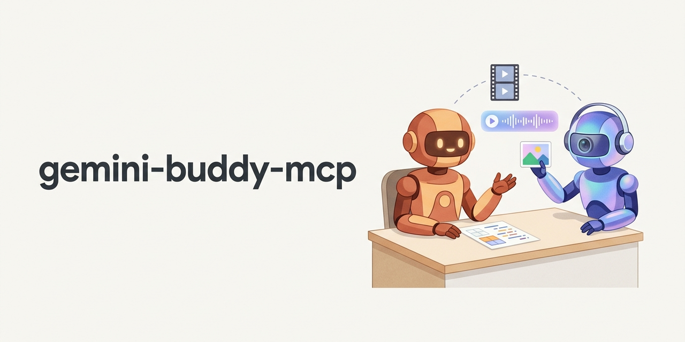

# gemini-buddy-mcp



<sub>この絵も gemini-buddy-mcp で作りました（`gemini_consult` で Gemini と案を相談し、`gemini_generate_image` の `backend="agy"` で生成）。</sub>

Claude Code などの MCP クライアントから Gemini を「相棒」として呼ぶための、stdio 型の MCP サーバーです。[agy-media](https://github.com/holmesfems/agy-media)（スキル版）の中身をすべて MCP のツールに移しました。

- **作業を任せる**：`gemini_delegate_*` で、`agy` にコードの作業を丸ごと任せられます。毎回新しい git worktree で動かし、`agy` が読み書きできるのはその中だけです。マージはせず、差分を返します。
- **相談・メディア解析・コードレビュー**：本サーバーが、サブスクでログイン済みの [Antigravity CLI](https://antigravity.google/)（`agy`）をサブプロセスで実行します。子プロセスの環境変数から `GEMINI_API_KEY`・`GOOGLE_API_KEY` を削除するため、**API キーによる課金は発生しません**。
  - `agy acp`（[Agent Client Protocol](https://agentclientprotocol.com/) のサーバー）を 1 つ起動したままにして、呼ぶたびに新しいセッションを開きます。`agy -p` を毎回起動するより 1 回あたり 2 秒ほど速く、サインインは `agy` のログイン（`oauth-personal`）をそのまま使います。
  - `backend="agy"` の画像生成だけは、これまでどおり `agy -p` で実行します（理由は「安全のために」）。
- **画像・音声の生成**：既定では `GEMINI_API_KEY` を使って `google-genai` SDK（API のクレジット枠）で実行します。画像生成のみ、`backend="agy"` を指定することで `agy` 組み込みの画像生成（サブスク枠）も使用できます。
- **機械的な下ごしらえと計測（ローカル実行）**：AI モデルを使わずローカルで処理します（ffmpeg での切り出し・コマ画像化・座標の目盛り、無音区間・ラウドネス・スペクトログラム、声と BGM の音量差、OpenCV での追跡、座標の描き込み確認）。
- **セッション管理**：どのツールも `session_id` を受け取れます。会話・解析したメディアの要約・生成したファイルの記録は `~/.gemini-buddy-mcp/sessions/<session_id>.json` に保存され、同じ `session_id` を渡すことで続きから依頼できます。
- **返り値の形式**：すべてのツールはテキストとファイルパスのみを返します。画像や音声のバイナリデータは返しません。

> English: A stdio MCP server that lets Claude consult Gemini through the subscription-authenticated `agy` CLI (API keys are stripped from its environment) for second opinions, media analysis and code review; generate images and speech with the `google-genai` SDK; and prepare / measure media locally (ffmpeg, numpy, OpenCV). Every tool shares a persistent `session_id`. Tools return text and file paths, never binary data.

## ツール

### Gemini に頼む

| ツール | 使う枠 | すること |
|---|---|---|
| `gemini_consult(prompt, file_paths?, session_id?, model?)` | agy | コードや設計のセカンドオピニオン。`file_paths` で渡したファイルは Gemini が自分で開いて読む |
| `gemini_analyze_media(file_path, prompt, session_id?, model?, more_files?)` | agy | 動画・音声・画像を見て・聞いての文字起こし、話者分け、画面の動き、BGM が場面に合うか、おおよその座標。回答の要約をセッションに保存する |
| `gemini_review(repo, base?, commit?, staged?, intent?, models?, allow_secret_like?, session_id?, out_dir?)` | agy | git の差分を読み取り専用でレビューする。既定は Neon 1 モデル（Claude と組むなら、別の Gemini を足しても視点はあまり広がらない）。複数のモデルを指定した場合、同じ箇所への指摘をまとめる。答えから指摘の JSON を読めなかったときは、答えの文を `unparsed` で返す |
| `gemini_generate_image(prompt, output_path, session_id?, backend="api")` | API / agy | 画像を生成・保存し、ファイルパスを返す。`backend="agy"` を指定するとサブスク枠を使用（1 枚あたり 50 秒ほど） |
| `gemini_generate_audio(text, output_path, voice_name="Kore", session_id?)` | API | TTS で音声を生成・保存し、ファイルパスと長さ（秒）を返す。**`text` には読み上げる本文のみを書く**（「Say cheerfully:」のような指示文を書くと、その指示文自体も読み上げられる） |
| `gemini_list_sessions(limit=20)` | — | 保存したセッションを新しい順に一覧表示する（`session_id`・更新日時・タイトル・関係するファイル） |

### Gemini に作業を任せる（`gemini_delegate_*`）

| ツール | すること |
|---|---|
| `gemini_delegate_start(task, repo, base?, model?, allow_commands?, session_id?)` | 新しい git worktree（`base` から切った `gemini-buddy/<id>` ブランチ）で、`agy` に作業を任せる。すぐに `task_id` を返す |
| `gemini_delegate_status(task_id, wait_seconds=0, since=0)` | 経過（ツール呼び出しと許可・拒否、途中の文）を返す。終わっていれば `agy` のまとめ（`response`）と変更（`changes`：ファイル一覧・stat・`patch_file`・差分）も返す。`wait_seconds`（最大 110 秒）だけ終わるのを待てる |
| `gemini_delegate_reply(task_id, message)` | 終わったタスクの同じセッションに続きを頼む（レビューで見つけた点を直させる、など） |
| `gemini_delegate_cancel(task_id, discard=False)` | 止める（`agy` のプロセスごと終わらせる）。`discard=True` で worktree とブランチも消す（終わったタスクの片付けにも使う） |

- **マージはしません**。終わったら変更を worktree でステージし、差分を `changes.patch` に書きます。MCP クライアントが差分を読んで確かめてから取り込みます（例：`git apply <patch_file>`）。`agy` の「直した」「テストが通った」は主張として扱ってください。
- `base` の既定は `HEAD` です。手元の**コミットしていない変更は worktree に入りません**。
- `allow_commands`：`agy` に許すコマンド（例：`["python -m unittest"]`）。先頭が一致すれば引数を付けられます。パイプ・リダイレクト・`&&`・`;`・`$`・`%` を含むものは断ります。既定は「コマンドなし」です。
- `agy` は拒否されるとターンを終えるので、本サーバーが「それ抜きで続けて」と最大 2 回まで促します（`nudges`）。
- `status` の値：`starting` → `checking`（切り離しの確認）→ `running` → `done` / `failed` / `stopped`（`agy` が許されないことをした。`warnings` を参照）/ `cancelled` / `interrupted`（作業中にサーバーが止まった）。
- タスクの記録は `~/.gemini-buddy-mcp/delegate/<task_id>/`（`task.json`・`changes.patch`・`wt/`）に残ります。サーバーを再起動しても `status` は読めます。

### ローカルの下ごしらえと計測（AI モデルは使わない）

| ツール | すること |
|---|---|
| `media_clip(video_path, start, end, …)` | `agy` に渡す小さな mp4（既定 720p・30fps）を切り出す |
| `media_frames(video_path, start, end, fps, crop?, grid?, sheet?, …)` | 指定範囲をコマ画像にし、`index.json`（各コマの元動画での秒・切り抜きのずれ）を出力する。`grid=100` で**元動画の座標**の目盛りを描く。`sheet` で一覧画像を生成する |
| `media_audio(src_path, start, end, …)` | `audio.wav`（モノラル 16 kHz）・波形・スペクトログラム・ラウドネス（LUFS）・音のある区間／無音区間（元ファイルの秒）を出力する |
| `media_mix_balance(mix_path, voice_path, …)` | 声だけのトラックを完成品に位置合わせして差し引き、声と BGM の音量差と、声が埋もれる区間（`buried_spans`）を出力する |
| `media_track(video_path, start, end, box, …)` | OpenCV のテンプレートマッチングで 1 つの対象を追跡する（全フレームの中心座標と一致度） |
| `media_overlay(index_path, track_paths?, points?, …)` | 座標をコマに描き込んで並べた確認用画像を生成する。Gemini の回答（`points`）と追跡結果を色違いで重ねられる |

### セッションと出力先のルール

- **`session_id` を省略した場合の動作**：
  - **Gemini に頼むツール**：本サーバーが新しいセッションを作成します（タイトルは最初のプロンプトの先頭 60 文字）。
  - **ローカルのツール**：新しいセッションは作成しません。
- **ローカルツールの出力先を省略した場合の動作**：
  - `session_id` あり：`~/.gemini-buddy-mcp/work/<session_id>/` の下に新しいフォルダを作成します。
  - `session_id` なし：`~/.gemini-buddy-mcp/work/_misc/` の下に新しいフォルダを作成します。
- **クライアントへの注意事項の伝達**：本サーバーは MCP の `instructions` を通じて、下記の「確かめ方」を MCP クライアントに渡します。

## 確かめ方（agy の回答を検証するルール）

MCP クライアント（Claude など）および人間は、`agy`（Gemini）の回答をそのまま事実として採用せず、用途ごとに以下の基準で必ず検証してください。

- **座標**：
  1. `media_frames` で目盛り付きのコマ画像を生成する。
  2. `gemini_analyze_media` にモデル `gemini-4-neon-high` を指定して座標を読み取らせる。
  3. 返された座標を `media_overlay` でコマ画像に描き込み、クライアント（または人間）が画像を目視確認する。
- **時刻（タイムスタンプ）**：
  - **使用するツール**：正確な時刻の特定には Gemini の回答を使わず、`media_audio` の `sound_spans` を使用する。
  - **根拠**：Gemini が返す時刻は 0.5〜1 秒ずれる。一方、`media_audio` の無音区間は発話の区切りとほぼ一致する（実測で字幕との差は 0.05 秒以内）。
- **BGM の音量と曲調**：
  - **音量差・声が埋もれる時刻**：`media_mix_balance` の数値および `buried_spans` で判断する（トーク動画の目安：BGM が声より 12〜20 dB 下）。Gemini に埋もれ時刻の特定は任せない（実測では「BGM が大きめ」という全体の傾向は当てたが、「声が埋もれている」と挙げた時刻は外れていた）。
  - **曲調が場面に合うか**：Gemini に判断を任せてよい。ただし決定ではなく「1 つの意見」として扱う。
- **発音の違和感**：
  - Gemini による発音の違和感の指摘は「確認候補」として扱い、**必ず人間が音声を聞いて最終確認する**（モデルごとに指摘する語がばらつくため）。
- **コードレビュー（`gemini_review`）**：
  - **全件検証の原則**：MCP クライアント（Claude など）は、ユーザーへ報告する前にすべての指摘を 1 件ずつ実際のコード上でたどって検証する。
  - **`agreed`（同じ箇所を指摘したモデル数）に基づく判断の禁止**：
    - `agreed` が多い場合でも、実際のコードを確認する前に「本物の不具合」と断定してはならない（必ずコードで裏付けを取る）。
    - 1 モデルのみが指摘した場合でも、単独指摘であることを理由に除外してはならない（本物の不具合が含まれるため、同様にコードで検証する）。
  - **`intent` 引数の記述ルール**：`intent` には**作者の意図のみ**を記述する。Claude 自身の意見や推測は混ぜない。

## 必要なもの

- Python 3.10+
- `agy`（インストールおよびログイン済みであること。`agy models` を実行してモデル一覧が表示されること）
  - ACP でサインインできないと言われたら、ターミナルで一度 `agy acp --login` を実行してください（Google のサインインが開きます）。`agy acp` の標準エラーは `~/.gemini-buddy-mcp/agy-acp.log` に出ます。
- `GEMINI_API_KEY`（API 枠で画像生成・TTS を使う場合のみ必要）
- Pillow・numpy・OpenCV・ffmpeg（ローカルのツールに必要。`[media]` オプションでインストールされる。PATH 上に `ffmpeg` がない場合は、自動で `imageio-ffmpeg` 同梱のものを使用する）
- git（`gemini_review` と `gemini_delegate_*` に必要）

## 入れ方

```powershell
git clone https://github.com/holmesfems/gemini-buddy-mcp
```

```powershell
cd gemini-buddy-mcp
```

```powershell
python -m venv .venv
```

```powershell
.venv\Scripts\python -m pip install -e ".[media]"
```

## Claude Code への登録

venv 内の実行ファイルを指定して登録します（パスは clone した場所に合わせてください）。`--scope user` を付けると、どのプロジェクトからも利用できます。

Windows（PowerShell）：

```powershell
claude mcp add gemini-buddy --scope user -- "C:\path\to\gemini-buddy-mcp\.venv\Scripts\gemini-buddy-mcp.exe"
```

macOS / Linux：

```bash
claude mcp add gemini-buddy --scope user -- /path/to/gemini-buddy-mcp/.venv/bin/gemini-buddy-mcp
```

`uv` を使う場合（リポジトリを clone せずに登録する場合）：

```powershell
claude mcp add gemini-buddy --scope user -- uvx --from "gemini-buddy-mcp[media] @ git+https://github.com/holmesfems/gemini-buddy-mcp" gemini-buddy-mcp
```

### API キーの設定（API 枠の画像生成・TTS を使う場合のみ）

API 枠の画像生成・TTS 以外のツールは、`agy` のログインとローカル環境だけで動作します。

- **推奨手順**：`GEMINI_API_KEY` を OS のユーザー環境変数に設定してください（Windows なら「環境変数を編集」からユーザー環境変数に追加）。本サーバーが自動で引き継ぎます。
  - **設定後の必須操作**：キーを設定したあとは、Claude Code（デスクトップアプリの場合はアプリ全体）を**再起動**してください。起動中のプロセスには新しい環境変数が反映されません。
- **非推奨（避けるべき設定）**：`claude mcp add` に `-e GEMINI_API_KEY=$env:GEMINI_API_KEY` を付ける登録方法は使用しないでください。以下の 2 つの問題が起きます。
  1. キーの値が `~/.claude.json` に平文で保存される。
  2. 登録を実行したシェルにキーがまだ設定されていない場合、**空文字として登録される**（この場合、生成ツールは `set but empty` エラーを返す）。

### タイムアウトの設定

`agy` の応答には 10 秒〜数分かかります（コードレビューは 1 モデルあたり 2〜6 分）。Claude Code 側で先にタイムアウトする場合は、Claude Code の起動前に環境変数 `MCP_TOOL_TIMEOUT`（ミリ秒）を長めに設定してください。

## 設定（環境変数）

| 変数 | 既定 | 意味 |
|---|---|---|
| `GEMINI_API_KEY` | — | API での生成に使うキー（`agy` の子プロセスには渡さない） |
| `GEMINI_BUDDY_CONSULT_MODEL` | `gemini-4-neon-high` | `gemini_consult` の `agy` モデル |
| `GEMINI_BUDDY_MEDIA_MODEL` | `gemini-4-hydrogen-high` | `gemini_analyze_media` の `agy` モデル |
| `GEMINI_BUDDY_AGY_IMAGE_MODEL` | `gemini-4-hydrogen-high` | `backend="agy"` の画像生成で使う `agy` モデル |
| `GEMINI_BUDDY_IMAGE_MODEL` | `gemini-nano-banana-2.1` | API の画像生成モデル |
| `GEMINI_BUDDY_TTS_MODEL` | `gemini-3.8-flash-tts` | API の読み上げモデル |
| `GEMINI_BUDDY_AGY_TIMEOUT` | `600` | `agy` を待つ秒数（`gemini_review` は 1 モデルあたり 900 秒） |
| `GEMINI_BUDDY_AGY` | PATH の `agy` | `agy` の実行ファイル |
| `GEMINI_BUDDY_AGY_BACKEND` | `acp` | 相談・メディア解析・レビューの呼び方。`acp` = 起動したままの `agy acp`、`cli` = 毎回 `agy -p`（ACP で困ったときの戻し先。レビューは `--json-schema` で答えの形を強制する） |
| `GEMINI_BUDDY_DELEGATE_MODEL` | `gemini-4-neon-high` | `gemini_delegate_start` の `agy` モデル |
| `GEMINI_BUDDY_DELEGATE_TIMEOUT` | `1800` | 任せた作業 1 回（start または reply）を待つ秒数。過ぎたら止める |
| `GEMINI_BUDDY_DELEGATE_IDLE` | `1800` | 終わったタスクの `agy` を `gemini_delegate_reply` のために残しておく秒数 |
| `GEMINI_BUDDY_AGY_APP_DIR` | `~/.gemini/antigravity-cli` | `agy` の設定フォルダ（任せる作業用の `gemini-buddy-delegate/settings.json` をこの下に書く） |
| `GEMINI_BUDDY_HOME` | `~/.gemini-buddy-mcp` | セッションと作業フォルダを置く場所 |
| `AGY_BRAIN_DIR` | `~/.gemini/antigravity-cli/brain` | `agy` が画像を保存するフォルダ（`backend="agy"` で取り出す） |

API の画像生成または TTS がモデル ID の不一致で失敗した場合、エラーメッセージにその API キーで利用可能な近い名前のモデル一覧が出力されます。その中から適切な ID を選び、`GEMINI_BUDDY_IMAGE_MODEL` または `GEMINI_BUDDY_TTS_MODEL` に設定してください。

## Gemini 4 のモデルの比べ（agy-media での実測、agy 1.5.12）

同じ素材で Argon・Neon・Hydrogen（いずれも High）を比較し、既定のモデルを選定しました。

| 試したこと | Argon | Neon | Hydrogen | 使うモデル |
|---|---|---|---|---|
| 音声 40 秒の文字起こし・話者分け | 本文・話者とも正しい／70 秒 | 同じ／103 秒 | 同じ／49 秒 | Hydrogen |
| 発音の違和感の指摘 | 12 件（多すぎる） | 3 件 | 3 件 | どれも候補扱い |
| 動画 40 秒（ロゴ・タイトル・セリフ） | 正しい／86 秒 | 正しい／52 秒 | 正しい／45 秒 | Hydrogen |
| 目盛り付きコマの座標（6 か所） | 字幕を 140 px 外す | 2 px 以内 | 縦に 8 px ずれ | Neon |
| コードレビュー（4 つ埋めたバグ） | 4/4／161 秒 | 4/4 ＋本物の競合 1 件／217 秒 | 4/4／90 秒 | Neon |

- **Flash 系モデル**：実測では音声入力のあと出力が途切れて失敗したため、既定モデルには採用していません。
- **動いている対象の座標（ゲーム録画の敵の位置）**：
  - おおよその位置や動きの流れを把握する用途には Gemini を使用できます（ただし実測では目盛りなしで約 100 px、目盛りありでも移動中は 50〜90 px ずれました）。
  - 精密な位置合わせが必要な場合は `media_track` を使用してください（制約：エフェクトが激しく重なる対象は見失いやすい）。
- **コードレビューの差**：意図的に埋めた 4 件とは別に存在した本物の不具合（保存の競合）を見つけられたのは Neon だけでした。

## 安全のために

- **`agy` の実行モードとアクセス範囲**：
  - **通常時（相談・メディア解析・コードレビュー）**：本サーバーは `agy` を plan モード（読み取り専用）で動かし、`--dangerously-skip-permissions` は付与しません。`agy` が読めるのは、空の作業フォルダと、渡したファイルのあるフォルダ（`--add-dir`、ACP では `additionalDirectories`）のみです。
  - **ACP（相談・メディア解析・レビュー）**：セッションは必ず plan モードで開き、`agy` から届く許可の求め（`session/request_permission`）はすべて断って `denied_actions` に記録します。ファイルの読み書き・端末の機能はクライアントとして提供しません。
    - **plan モードに限る理由**：ACP の `default`・`accept-edits` モードでは、`agy` は自分の `settings.json` で許されたコマンド（`"toolPermission": "proceed-in-sandbox"` ならサンドボックス内のコマンド全般）を、許可を求めずに実行します（2026-11 の実測で `echo` が聞かれずに動いた）。plan モードではコマンドを実行せず、計画を書くだけでした。
  - **例外（`backend="agy"` の画像生成）**：`agy -p` を `accept-edits` で、毎回使い捨ての空フォルダで起動します（そこに書かれたものが、ほかのセッションに見えないように）。ACP では画像生成がサブエージェントに回され、ターンが終わってから結果が返るので（完了の通知は来ない）、今は使いません。
  - **`agy -p` の厳しい設定**：`agy -p` は毎回 `--settings` で `{"permissions": {"allow": [], "deny": ["command(*)", "write_file(*)"]}}` を渡し、ユーザーの `settings.json` の `allow` を打ち消します（`deny` が優先される）。画像生成は `write_file` を使わずに画像を保存するので、これで動きます。ACP（`agy acp`）には `--settings` が無いので、plan モードと許可の拒否で守ります。
  - **コードレビュー**：ACP には `--json-schema` に当たる仕組みが無いので、プロンプトで JSON の形を頼み、答えの中から探して読みます（そのまま・```json の囲み・前置きのあと）。読めなかったときは答えの文を `unparsed` で返すので、MCP クライアントが読んでください。
- **任せる作業（`gemini_delegate_*`）の守り**：plan モード以外を使うので、次の何重かで `agy` を worktree の中に留めます（agy 1.5.14 の実測、2026-11）。
  - **普段の設定から切り離す**：タスクごとに `agy acp --cli_dir_name gemini-buddy-delegate` を起動します。`agy` はユーザーの `settings.json` の代わりに `~/.gemini/antigravity-cli/gemini-buddy-delegate/settings.json` を読みます。本サーバーが起動のたびにこのファイルを `"toolPermission": "strict"`・`allow` / `deny` / `ask` を空で書き直します（このフォルダは本サーバーのものです。手で直しても上書きされます）。strict では、ファイルの読み・書き・コマンドのすべてで許可を求めてきて、こちらの答えに従いました。サインインは普段の `agy` のログインのままです。
  - **許可の決まり**：worktree の中のファイルの読み書きだけを許します（`.git` と、`.env`・鍵・`credentials` に当たる名前は除く）。コマンドは `allow_commands` に一致するものだけで、`agy` の端末のサンドボックスの中に限ります（サンドボックスで失敗すると `agy` は `BypassSandbox: true` で聞き直してくるので、それは断る）。ほかは全部断ります。
  - **切り離しの確認（毎回）**：`agy` の更新で `--cli_dir_name` が黙って無視されるようになると、ユーザーの設定（`read_file(*)` の許可や `proceed-in-sandbox`）が戻り、守りが静かに外れます。そこで作業の前に、確認用のファイルを読むよう頼み、`agy` が先に許可を求めてくるかを見ます。聞かずに読んだら、作業を始めずに `failed` を返します（`--cli_dir_name` なしで起動して、実際に止まることを確かめた）。この確認はユーザーの設定が読み取りを許している前提で働きます。
  - **2 枚目の守り**：ツール呼び出しを見張り、サブエージェント（`invoke_subagent`。許可を求めずに動き、ターンが終わっても動き続ける）や、許可していない読み書き・コマンドが完了したら、`agy` のプロセスを終わらせて `stopped` にします。
  - **守れないもの**：`search_web` は strict でも許可を求めずに動きます（送るのは検索語で、ファイルではありません）。許したコマンドは、`agy` が書いたコードを（サンドボックスの中で）実行できます。
- **ヘッドレス `agy` のコマンド実行**：
  - 本サーバーから呼ぶ `agy` はシェルコマンドを実行しません（上の厳しい設定と plan モード）。MCP クライアント（またはユーザー）は、動画の切り出し等の前処理を事前に `media_*` ツールで済ませてから `agy` に渡してください。
  - **注意**：ヘッドレスの `agy -p` でも、`settings.json` の `allow` にあるコマンドは聞かれずに実行されます（2026-11、agy 1.5.14 の実測で `git status` が動いた）。以前この README に書いていた「ヘッドレスはコマンドを実行できない」は誤りでした。
  - 返り値に `denied_actions` が含まれている場合、`agy` が何らかのコマンドや操作を実行しようとして拒否された印です。
- **`gemini_review` のデータ送信と秘密情報の保護**：
  - **外部送信の前提**：`gemini_review` に渡されたコードは Google に送信されます。
  - **本サーバー側の自動保護**：
    - `.env`・鍵・`credentials` に該当するファイル（大文字・小文字を区別しない）は、自動で差分から除外します。
    - 差分のいずれかの行に API キーや秘密鍵らしい文字列を検知した場合、外部へ一切送信せず `STOPPED` を返します（`allow_secret_like` で明示的に許可しない限り）。
  - **ユーザー側で必要な追加対策（重要）**：`agy` プロセス自体はリポジトリ全体を読み取れます。リポジトリ内に秘密情報を含むファイルがある場合は、**ユーザー側で `agy` の `settings.json` の `deny` に、そのファイルかフォルダの絶対パスで読み取り拒否ルールを追加してください**。例：
    ```json
    "deny": [
      "read_file(C:/path/to/repo/.env)",
      "read_file(C:/Users/you/.ssh)"
    ]
    ```
    - **ファイルの絶対パス**はそのファイルだけ、**フォルダの絶対パス**はその中のすべてを拒否します。ほかのフォルダの `.env`（例：`sub/.env`）は守られないので、ファイルごとに書いてください。
    - **`regex:` やグロブの形は使わないでください**（agy 1.5.14 の実測、2026-11）：
      - `read_file(regex:.*\.env.*)` や `read_file(**/.env*)` は、`.env` の読み取りを**止めませんでした**。
      - しかも端末のサンドボックスが `globs not supported`（`read_file(.env)` のような相対パスでは `non-absolute file path`）で起動できなくなり、agy は `BypassSandbox` でサンドボックスの外でコマンドを実行し直しました。サンドボックスは `read_file` の `deny` を絶対パスとして使うためです。
      - `ask` の `write_file(regex:…)` はサンドボックスを壊しませんでした。
    - 本サーバーの呼び出しはコマンドをすべて拒否するので、サンドボックスが壊れていても影響しませんが、普段の agy の利用では影響します。
- **`session_id` の検証**：
  - セッションフォルダ外へのアクセスを防ぐため、本サーバーは `session_id` として UUID 形式のみを受け付けます。

## テスト

`agy` および `GEMINI_API_KEY` は不要です（ローカルのツールは ffmpeg で生成した動画・音声を使用して検証します）。

```powershell
.venv\Scripts\python -m unittest discover -s tests
```
